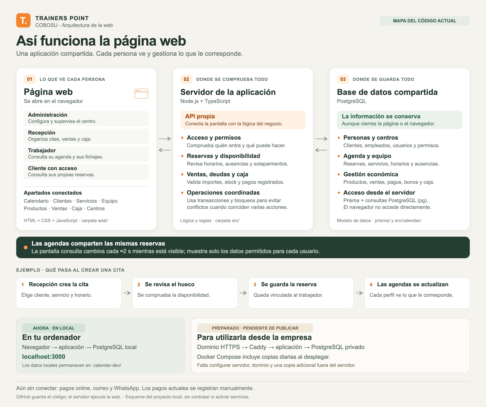
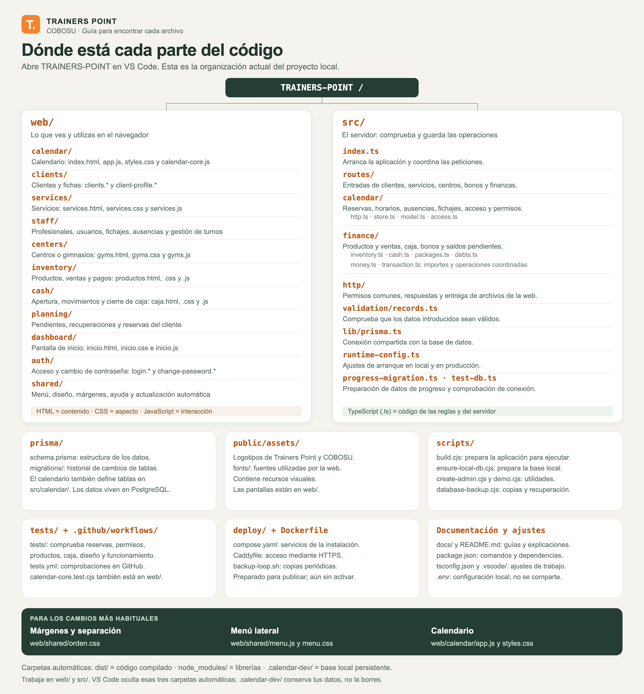

# Cómo funciona Trainers Point

Este mapa describe el código local revisado el 4 de noviembre de 2026. Se puede compartir la imagen PNG o editar el original SVG. No es un despliegue ni implica haber contratado servicios.

## Explicación sencilla

1. Cada persona entra con su usuario: administración, recepción, trabajador o cliente con acceso.
2. La página envía sus acciones a la API propia de Trainers Point, que es la conexión entre las pantallas y el servidor.
3. El servidor revisa los permisos y las reglas del negocio: horarios disponibles, reservas, existencias, ventas, deudas y caja.
4. PostgreSQL conserva la información. Recepción y los trabajadores consultan las mismas reservas, con distinta visibilidad según su perfil.
5. El calendario consulta cambios aproximadamente cada dos segundos mientras está visible y hay conexión. Esta actualización utiliza consultas periódicas, no WebSockets.

El ejemplo de la imagen representa una cita con trabajador asignado. También existen reservas pendientes de asignación: recepción las resuelve y entonces aparecen en la agenda del trabajador correspondiente.

## Dónde funciona

Actualmente la aplicación funciona en local, en `http://localhost:3000/`. El código incluye una configuración para publicarla con Docker Compose, Caddy para HTTPS, PostgreSQL privado y copias diarias. Esa configuración está preparada; todavía deben configurarse el servidor, el dominio y un destino externo para las copias.

Los pagos actuales registran dinero recibido. No ejecutan cargos bancarios. Los cobros online, correo y WhatsApp son integraciones externas pendientes. GitHub guarda el código, pero no ejecuta esta aplicación.

## Relación con el código

- [Pantallas y carpetas](../estructura-y-optimizacion.md).
- [Arranque y coordinación del servidor](../../src/index.ts).
- [Acceso y perfiles](../../src/calendar/access.ts).
- [Permisos y operaciones de calendario](../../src/calendar/http.ts).
- [Actualización automática compartida](../../web/shared/polling.js).
- [Modelo de datos](../../prisma/schema.prisma).
- [Operaciones económicas](../../src/finance/).
- [Configuración de despliegue](../../deploy/compose.yaml).
- [Estado y puesta en marcha](../puesta-en-marcha.md).

Archivos de esta entrega: `funcionamiento-trainers-point.png`, `funcionamiento-trainers-point.svg` y este documento. Son documentación y no modifican el funcionamiento de la aplicación.

## Mapa del código

Este segundo esquema muestra las carpetas y los archivos principales del proyecto. Su original editable es `organizacion-del-codigo.svg`. En las etiquetas, `clients.*` significa los archivos con ese nombre y sus distintas extensiones, como `.html`, `.css` y `.js`.

Para orientarte en VS Code, abre la carpeta **TRAINERS-POINT** y despliega **web** para ver las pantallas o **src** para ver las reglas del servidor. Puedes pulsar **⌘P** y escribir el nombre del archivo.

- Márgenes y separación: [orden.css](../../web/shared/orden.css).
- Menú lateral: [menu.js](../../web/shared/menu.js) y [menu.css](../../web/shared/menu.css).
- Calendario: [app.js](../../web/calendar/app.js) y [styles.css](../../web/calendar/styles.css).
- Reglas de reservas: [model.ts](../../src/calendar/model.ts) y [store.ts](../../src/calendar/store.ts).
- Estructura de los datos: [schema.prisma](../../prisma/schema.prisma).

Los mapas forman parte de la documentación del proyecto. La publicación se prepara sin contratar servicios; servidor, dominio y proveedor de pagos siguen pendientes.
